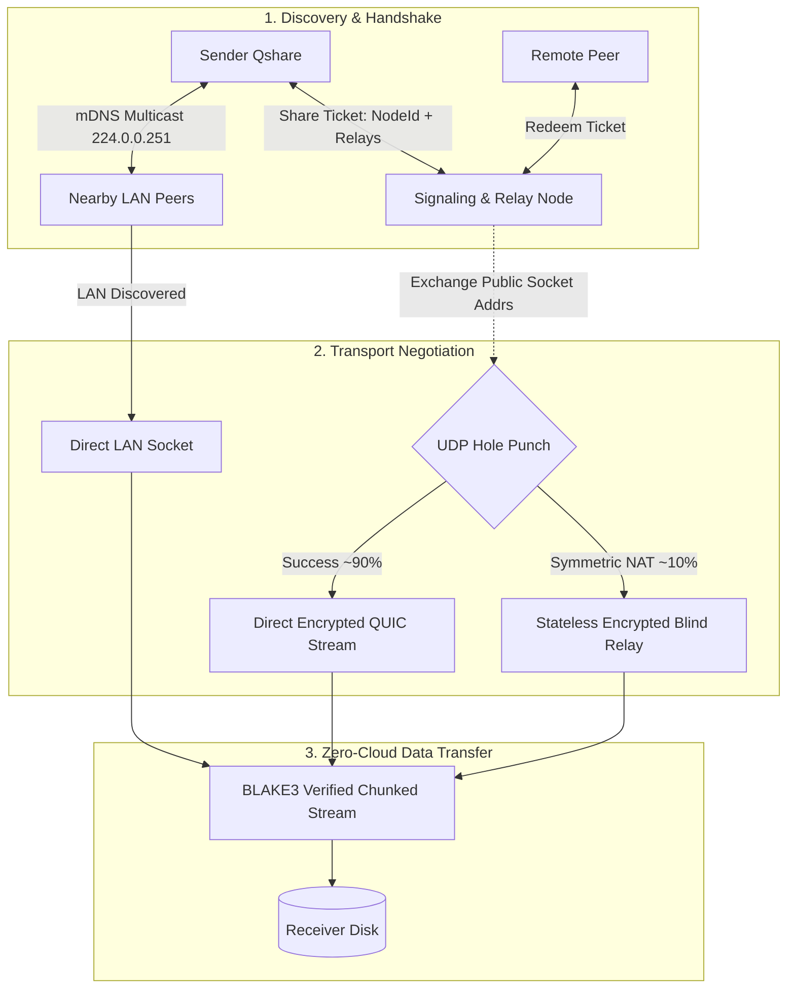

# Qshare (⚡)

> **Zero-Cloud Hybrid P2P Dropzone for Desktop**  
> *100% Pure Rust · GPU-Accelerated UI via Iced · QUIC Hole-Punching via Iroh · Zero Cloud Storage*

[](https://www.rust-lang.org/)
[-blue.svg)](https://iced.rs/)
[-purple.svg)](https://iroh.computer/)
[](LICENSE)

---

## 🌟 Overview

**Qshare** is a lightweight, privacy-first desktop file transfer application built in pure Rust. It solves the friction of moving files between devices without sacrificing speed or privacy:

1. **Local LAN Mode (Zero Internet Needed):** When devices share the same Wi-Fi or Ethernet switch, local multicast discovery finds peers automatically. Files stream directly across the router at full line speed (100+ MB/s) even if your internet connection goes down.
2. **Across the Internet (Cloud-Assisted Direct P2P):** When sending across different networks or cities, sender and recipient exchange a short cryptographic **Share Ticket**. A lightweight signaling node coordinates a simultaneous UDP hole-punch, establishing a direct, end-to-end encrypted QUIC tunnel between both computers.
3. **Stateless Fallback (Zero Cloud Persistence):** If strict corporate firewalls block direct hole punching, traffic falls back to a blind encrypted relay stream. **Zero bytes ever touch cloud disk**—packets stream through server RAM in real-time with zero logging and end-to-end encryption.

---

## 🚀 Key Highlights

- **0 MB Cloud Storage:** No subscription fees, no file size caps, and zero third-party data collection.
- **Pure Native Performance:** Built with `Iced` drawing directly to your GPU via `wgpu`. Instant window startup (30–50 ms), tiny idle RAM footprint, and zero Chromium or Electron bloat.
- **Cryptographic Verification:** Every transfer is hashed and verified chunk-by-chunk using **BLAKE3**. Interrupted or corrupt files are caught instantly without mangling your destination folder.
- **Sleek Split-Interface:**
  - **Local Radar Tab:** Visual avatars of nearby peers discovered over mDNS.
  - **Send Anywhere Tab:** Drag-and-drop dropzone with ticket code generation and real-time route badges (**Local LAN** / **Direct P2P** / **Encrypted Relay**).

---

## 🏗️ Architecture at a Glance



---

## 📁 Repository Structure

```text
Qshare/
├── Cargo.toml               # Project metadata and dependencies (iced, iroh, tokio, etc.)
├── AGENTS.md                # AI agent instructions, post-session protocol, and architectural invariants
├── README.md                # Public overview and quick-start guide
├── docs/                    # Context tracking and technical documentation suite
│   ├── ARCHITECTURE.md      # Deep technical architecture, protocol, and security specs
│   ├── ROADMAP.md           # Living milestone tracker and progress checklist
│   ├── KNOWN_ISSUES.md      # Bug register and resolved issue history
│   └── ADR/                 # Architecture Decision Records
│       └── 0001-hybrid-p2p-iroh-iced-architecture.md
└── src/
    ├── main.rs              # Application entry point (Iced app launcher)
    ├── app.rs               # Iced state machine: State, Message, update(), view()
    ├── types.rs             # Core data contracts (Peer, Ticket, TransferState)
    ├── ui/                  # Visual components, styling tokens, and view layouts
    └── core/                # Headless networking engine (Iroh + LAN discovery)
```

---

## 🛠️ Quick Start (Development)

### Prerequisites
- **Rust Toolchain:** Stable 1.80+ (MSVC on Windows).
- **Git**

```bash
# Clone the repository
git clone https://github.com/Jabir-A-H/Qshare.git
cd Qshare

# Check compilation
cargo check

# Run in development mode
cargo run

# Build optimized release binary
cargo build --release
```

---

## 📖 Documentation Suite

- [**Architecture Specification**](docs/ARCHITECTURE.md): Comprehensive system architecture, networking protocol, and threat model.
- [**Roadmap**](docs/ROADMAP.md): Current sprint progress, completed phases, and upcoming features.
- [**Known Issues**](docs/KNOWN_ISSUES.md): Active bugs, edge cases, and historical resolved register.
- [**Architecture Decisions (ADRs)**](docs/ADR/): Formal records of all key technical decisions.

---

## 📄 License

Licensed under either of [Apache License, Version 2.0](LICENSE-APACHE) or [MIT License](LICENSE-MIT) at your option.
